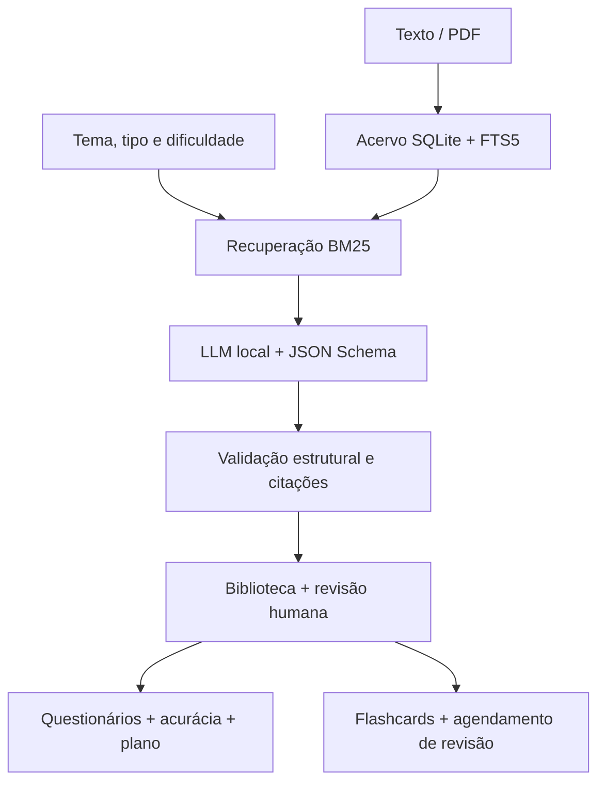

# Memorix

Backend educacional em Python que transforma um acervo de textos e PDFs em materiais de estudo com IA local, revisão humana e acompanhamento de desempenho.

**Estado atual:** funcional pela CLI, com persistência local em SQLite. Ainda não há interface web/mobile, contas ou separação de dados por aluno.

## Funcionalidades implementadas

| Área | Entrega atual |
| --- | --- |
| Acervo | Importação de texto UTF-8, Markdown e PDF com texto extraível; divisão em trechos e busca lexical FTS5/BM25. |
| Geração com RAG | Flashcards, múltipla escolha, verdadeiro/falso e aulas, com tema, quantidade e dificuldade explícitos. |
| Rastreabilidade | Citações literais verificadas, vinculadas ao documento, trecho e página do PDF. |
| Revisão humana | Biblioteca de rascunhos, edição, aprovação e rejeição com controle de versão. |
| Questionários | Sessões com gabarito oculto até o envio, correção objetiva e feedback com fontes. |
| Desempenho | Histórico e acurácia geral, por material, versão e questão. |
| Plano de prática | Priorização de erros, diagnóstico e consolidação; indicação de aulas/flashcards por trechos compartilhados. |
| Flashcards | Revelação do verso, autoavaliação e repetição espaçada por caixas, com fila de cartões novos e vencidos. |

**Limite da IA:** validar estrutura e citações comprova a origem do trecho, não a correção pedagógica da resposta. Todo material gerado entra como `requires_review`; estudar exige aprovação humana e fontes atuais.

## Arquitetura e decisões técnicas



- **Execução local:** a CLI usa a biblioteca padrão do Python; `pypdf` é necessário para PDFs. Geração e classificação são componentes separados.
- **Saída estruturada:** schemas por formato e validação após a geração; respostas inválidas são recusadas, sem reparação silenciosa ou fallback para conhecimento externo.
- **Consistência:** transações SQLite, controle de concorrência por versão e snapshots das sessões preservam os resultados históricos após edições.
- **Fontes atuais:** alterações no acervo podem invalidar referências; aprovação e sessões abertas revalidam material e fontes antes de prosseguir.
- **Rede restrita na geração:** cliente Chat Completions aceita apenas HTTP em `127.0.0.1` ou `[::1]`, sem proxies de ambiente ou redirecionamentos.
- **Classificador independente:** Laya identifica o tipo de pedido, mas ainda não participa do pipeline da CLI.

### Organização do código

```text
backend/
  src/Memorix/
    __main__.py          # Interface de linha de comando
    ingestion/           # Importação, trechos e busca
    contracts/           # Contratos de classificação e geração
    providers/           # Cliente LLM local e classificador Laya
    generation_adapter/  # Prompts, schemas e validação
    pipeline/            # Recuperação → geração → validação
    storage/             # Materiais e sessões em SQLite
    study/               # Correção, progresso, plano e repetição espaçada
    config/              # Configuração do classificador
  evals/                 # Testes automatizados
```

## Executar localmente

### 1. Acervo e CLI, sem GPU ou modelo

Requisitos: **Python 3.12+** e SQLite com **FTS5**. Execute a partir da raiz do repositório. No Linux/macOS:

```bash
python3 -m venv .venv
source .venv/bin/activate
python3 -m pip install pypdf==6.21.4

mkdir -p data
printf 'A fotossíntese converte energia luminosa em energia química.\n' > data/exemplo.txt
python3 -m backend.src.Memorix ingest data/exemplo.txt --title "Biologia"
python3 -m backend.src.Memorix search "fotossíntese" --limit 5
python3 -m backend.src.Memorix --help
```

No PowerShell, ative o ambiente com `.\.venv\Scripts\Activate.ps1`. PDFs são importados com `ingest arquivo.pdf`. Não há OCR; PDFs protegidos por senha ou sem texto extraível são recusados.

O banco padrão é `data/acervo.sqlite3`. Para outro arquivo, use `--db CAMINHO` **antes do subcomando**. Os comandos retornam JSON; erros operacionais tratados usam stderr e código de saída 2.

### 2. Gerar e revisar material

Inicie separadamente um servidor com API Chat Completions e suporte a `response_format.type = json_schema`. Exemplo com [llama.cpp](https://github.com/ggml-org/llama.cpp) e um modelo GGUF de instruções já baixado:

```bash
llama-server --model /caminho/modelo.gguf --alias local \
  --host 127.0.0.1 --port 8080 --ctx-size 8192 --parallel 1 \
  --n-gpu-layers 0 --log-disable
```

Com o servidor ativo e o acervo importado:

```bash
python3 -m backend.src.Memorix generate "fotossíntese" \
  --type multipla_escolha --count 3 --difficulty basica > data/rascunho.json &&
python3 -m backend.src.Memorix material-import data/rascunho.json
```

Tipos: `flashcards`, `multipla_escolha`, `verdadeiro_falso` e `aula`. Quantidade: 1–20 itens ou seções. Dificuldades: `basica`, `intermediaria` e `avancada`. Sem trechos correspondentes, o modelo não é chamado. A geração não persiste material automaticamente; a importação é explícita.

A importação retorna `material_id` e `version`. Substitua `ID` abaixo pelo identificador retornado. Inspecione conteúdo, gabarito e fontes **antes** de aprovar:

```bash
python3 -m backend.src.Memorix material-show ID
python3 -m backend.src.Memorix material-review ID --version 1 --decision approve
```

Uma importação nova começa na versão 1; a aprovação passa para a versão 2. Edições posteriores exigem nova revisão. Use sempre a versão atual retornada pela CLI. Para editar, exporte com `material-show ID --draft` e consulte `material-update --help`.

### 3. Estudar e acompanhar resultados

Para um questionário recém-aprovado, substitua `SESSAO` pelo `session_id` retornado em `study-start`:

```bash
python3 -m backend.src.Memorix study-start ID --version 2
python3 -m backend.src.Memorix study-submit SESSAO data/respostas.json
python3 -m backend.src.Memorix study-progress
python3 -m backend.src.Memorix study-plan --target 0.8 --limit 5
```

Crie `data/respostas.json` com uma resposta por questão, na ordem: índices de 0 a 3 para múltipla escolha (ex.: `[0, 1, 2]`) ou booleanos para V/F (ex.: `[true, false]`). O envio é único e integral. A correção usa o gabarito aprovado, sem enviar respostas à IA.

Para um material de **flashcards** aprovado, use seu identificador e versão atual:

```bash
python3 -m backend.src.Memorix flash-queue
python3 -m backend.src.Memorix flash-start ID --version 2
python3 -m backend.src.Memorix flash-reveal SESSAO --item 0
python3 -m backend.src.Memorix flash-rate SESSAO --item 0 --rating good
```

Use a sessão retornada por `flash-start` e o `item_index` do cartão atual. Avaliações: `again`, `hard`, `good` e `easy`. `again` agenda em 10 minutos; as caixas usam intervalos de 1, 3, 7, 14, 30 e 60 dias. É autoavaliação, não correção automática ou estimativa de retenção.

### Classificador de intenção (opcional)

Componente separado baseado em Laya, Transformers e PyTorch. A configuração atual exige GPU NVIDIA/CUDA 12.8 e `HF_TOKEN` com acesso ao modelo `Riupul/laya-multilingual-finetuning-memorix`:

```bash
python3 -m pip install -r requirements.txt --extra-index-url https://download.pytorch.org/whl/cu128
```

O token é lido do ambiente; `.env` não é carregado automaticamente. Essa instalação não é necessária para o acervo, estudo ou geração via servidor local.

## Testes

```bash
python3 -m unittest discover -s backend/evals -v
```

A suíte atual contém **128 testes**: ingestão e migração, contratos e citações, restrições de rede, revisão e conflitos de versão, rollback, envio concorrente, histórico, acurácia, plano e agendamento de flashcards. Requer `pypdf`, mas não GPU, token, pesos de modelo ou servidor de inferência externo; os cenários HTTP usam servidores temporários em loopback.

Os testes não medem qualidade pedagógica ou fidelidade semântica do conteúdo gerado.

## Limites e próximos escopos

- **Produto:** interface web/mobile, autenticação e papéis de aluno/admin ainda não implementados. O histórico atual é compartilhado por toda a instalação.
- **RAG:** busca lexical, sem embeddings, reranking ou interpretação integrada de pedidos em linguagem natural.
- **Pedagogia:** sem questões dissertativas, correção de texto livre ou avaliação automática de conteúdo. O plano prioriza prática por acurácia, não cria um calendário; recursos sugeridos compartilham trechos, sem garantia de relevância semântica.
- **Privacidade:** o banco e os JSONs contêm conteúdo e caminhos locais; não devem ser publicados. A restrição de rede do cliente não substitui a configuração segura do servidor de inferência nem representa certificação de conformidade com a LGPD.
